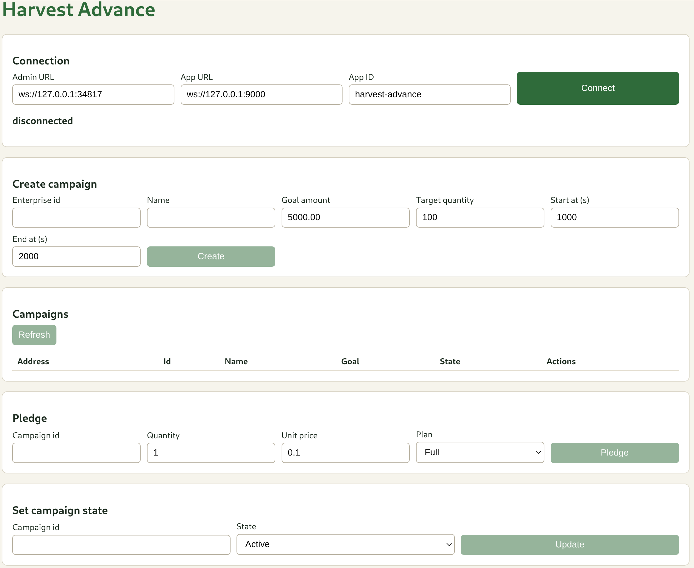

# Harvest Advance



**Pre-harvest financing for small farms, food hubs and co-ops.** Harvest Advance is a Holochain
hApp that lets a producer raise money *before* the crop exists — then coordinate
production, report progress, and settle up on a shared, agent-owned record. There
is no central server: every participant runs their own node and the data
replicates peer-to-peer.

## Status: alpha (v0.1)

Harvest Advance is an **alpha** project. The core lifecycle is implemented and
tested, but it is **not production-ready**: there has been no security audit, the
API may change between versions, and the demo runs on a single node.

It is meant as a **foundation to build on** — an agent-centric, modular substrate
(source-chain records, anchors/links, integrity-enforced lifecycle) that the
community can extend. The fixed wire identifiers (`harvest-advance` DNA, role and
zomes) are stable; new capabilities are added as additive, versioned modules, not
breaking changes. Feedback, issues and contributions are welcome.

## Who it's for

Harvest Advance is built for **local communities and small farms** that produce
**organic, higher-quality food at a smaller scale** — CSAs, market gardens,
smallholdings, community-supported fisheries, and food co-ops — rather than
industrial-scale commodity agriculture. The aim is to keep financing and value
within the community that grows and eats the food.

## The problem it solves

Small farms and food hubs need cash *before* harvest to buy seed, inputs and
labour — exactly when they have no revenue yet. Harvest Advance lets them open a
funding round, take pledges from their community, plan the crop in batches, post
dated field reports, and forecast the economics, all on infrastructure they own
together.

## Business logic

### The core loop

```
Enterprise → Funding campaign → Pledges → Accept / Decline
           → Payments (Full or installments) → Batches (production runs)
           → Batch reports (progress) → Projections (multi-period economics)
           → Complete   (or Default / Fail-to-deliver)
```

### Domain model

| Entity | Role |
|---|---|
| **Enterprise** | a farm, hub or co-op that runs campaigns (`owner_id`, `permalink`, `visible`) |
| **FundingCampaign** | a funding round with a goal amount, target quantity and date window; state `Draft → Active → Funded → Completed` (or `Canceled` / `Failed`) |
| **FundingContribution** | a pledge of `quantity × unit_price`, `Full` or 3-installment, with `paid_amount`; status `Pending → Accepted → Completed`, or `Declined` / `Defaulted` |
| **FundingBatch** | a production run (crop, variety, quantity, sowing/harvest dates); status `Planned → Growing → Ready → Packed → Delivered` (or `Failed`) |
| **BatchReport** | a dated field report (stage, health, expected/actual yield, notes) |
| **FundingProjection** + **ProjectionLine** | a multi-period cost/revenue plan with lines by category |
| **PickupLocation** | a collection/distribution point |
| **FarmersCluster** | a regional grouping of producers |
| **Profile** | per-agent contact details |

### Lifecycle rules

- **Campaigns** advance `Draft → Active → Funded → Completed`; they can be
  `Canceled`, or `Failed` on delivery failure.
- **Contributions** start `Pending`; the owner **accepts** or **declines** (a
  contributor may also withdraw). Payments are recorded explicitly — a fully paid
  contribution becomes `Completed`, and a missed payment can be marked
  `Defaulted` (failure to pay).
- **Batches** advance through the growing stages to `Delivered`, or `Failed`
  (failure to deliver).
- Campaign totals (`current_amount`, `fulfilled_quantity`) are recomputed by the
  owner from contributions, excluding declined/defaulted ones.

## What the scaffold represents

Harvest Advance is also a **reusable substrate** for any business that follows the
same shape: *commit now → produce in runs → report progress → deliver later,
coordinated across a region.* The same primitives — campaigns as commitments,
batches as production runs, reports as progress events, clusters as regional
coordination — apply to:

- CSA / farm subscriptions, dairy & fishery shares, ranch shares
- food hubs, buying clubs, direct-trade standing orders for restaurants
- craft & small-batch pre-orders (cheese, preserves, ceramics)
- community energy (subscribe to future production), carbon / ecosystem-service projects
- equipment-sharing co-ops, mutual aid, seed libraries

Architecturally it is **agent-centric** (each participant owns their source
chain), **eventually consistent** (no global ordering), and **offline-first** — a
coordination and record layer, not a central database.

## Fixed interface identifiers

These names are part of the peer/client contract and must not change:

| Item | Value |
|---|---|
| DNA name | `harvest-advance` |
| Role name | `harvest_advance` |
| Coordinator zome | `harvest_advance` |
| Integrity zome | `harvest_advance_integrity` |
| Installed app id (client convention) | `harvest-advance` |

## Layout

```
harvest-advance/
├── harvestadvance1.png        banner image
├── Cargo.toml                 workspace
├── crates/logic/              pure rules (money, transitions, ids, validation)
├── zomes/integrity/           integrity zome (entry defs, validation)
├── zomes/coordinator/         coordinator zome (zome calls)
├── dna/dna.yaml               DNA manifest
├── happ/happ.yaml             hApp manifest
├── ui/                        Vite + React + TypeScript client
├── tests/                     pure-logic unit tests + conductor tests (smoke + A/B)
└── LICENSE                    CAL-1.0
```

## Build

Toolchain: rustc/cargo 1.98, `wasm32-unknown-unknown`, `hc` 0.7.0, node 20, pnpm 12.

```bash
# 1. Build both zomes for wasm
cargo build --release --target wasm32-unknown-unknown \
  -p harvest_advance_integrity -p harvest_advance

# 2. Pack the DNA (writes dna/harvest-advance.dna or dist/)
hc dna pack dna

# 3. Pack the hApp
hc app pack happ
```

The `happ.yaml` references the packed DNA. Adjust paths there if you relocate bundles.

## Run / test

```bash
# Pure-logic unit tests (no conductor needed)
cargo test -p harvest-advance-logic

# Conductor smoke tests (48 assertions):       ./tests/conductor/run.sh
# A/B lifecycle tests (owner vs contributor):  ./tests/conductor/run-ab.sh
```

## Design notes

- **Money** is stored and transmitted as decimal strings with 2 fractional digits.
  All arithmetic uses an exact decimal type (`crates/logic/src/decimal.rs`); `0.1 × 3`
  produces `"0.30"` rather than a binary floating-point artefact.
- **Timestamps** are integer seconds (`i64`) on the wire, not `holochain_timestamp::Timestamp`
  (which serialises as RFC3339). Conversion happens only at the coordinator boundary.
- **Addresses** returned by reads are the original **create action hash** of a record. When a
  record is updated, the stored address stays stable and reads return the newest revision
  (`zomes/coordinator/src/records.rs`), so a state transition preserves the address while
  still being a true Holochain update.
- **Agent identities** (`owner_id`, `contributor_id`, `created_by`, `Profile.id`) are base64
  agent-key strings on the wire, not raw byte arrays. The integrity layer compares them
  against the author's base64 key.
- **Pledges do not mutate the campaign's `current_amount` / `fulfilled_quantity`.** Campaign
  updates require `owner_id == author`, so a contributor cannot update the campaign entry.
  The owner recomputes totals with `recalculate_campaign_totals` (Declined/Defaulted excluded).
- **Contribution lifecycle.** Each contribution carries a `status`: `Pending` on pledge, then
  `Accepted` / `Declined` (owner decision) or `Completed` / `Defaulted` (payment outcome).
  `Full` is one installment and `Installments` is three; both start unpaid and are paid via
  `record_payment`, which completes the contribution when `paid_amount == total_amount`.
- **`ProjectionLine.projection_id`** holds the parent projection's **action address**
  (base64 string), not its 32-hex `id`. This lets the integrity layer resolve the parent
  projection and authorise lines against its owner without adding a new link type.
  `get_projection_lines(campaign_id)` returns the lines.
- **Profiles** are indexed under the `profile/{agent}` anchor with link type 5 (the same
  anchor used for contributions), so one-profile-per-agent can be enforced;
  `get_my_contributions` filters type-5 links to contributions.
- **Projection lines** are linked from the campaign anchor with link type 4 (projections and
  their lines share that link type; validation accepts both targets). The 11 link types and
  their indices are unchanged.
- **Batch status** changes go through `set_batch_status(campaign_id, batch_id, status)`; the
  batch state machine is enforced in the integrity layer on update.
- **`Failed` campaign state** is reachable from `Active` / `Funded` (delivery failure).
- **Reserved link types** (CampaignProduct, EnterpriseLocation, ClusterList,
  EnterpriseProfile, CampaignCatalog) are declared in the required order and validated where
  an operation creates them.

## Test status

Three layers are provided:

- **Pure-logic unit tests** — `cargo test -p harvest-advance-logic` (16 tests: exact
  decimal math, transition tables, id formatting, validation rules, payment rules).
- **Conductor smoke tests** — `tests/conductor/smoke.mjs`, run via
  `./tests/conductor/run.sh` (48 assertions against the public zome-call surface).
- **A/B lifecycle tests** — `tests/conductor/ab-test.mjs`, run via
  `./tests/conductor/run-ab.sh` (two agents: owner + contributor; happy path and the
  decline / fail-to-pay / fail-to-deliver failure paths).

## AI disclosure

This project was developed with the assistance of AI coding agents. AI tools were
used to help draft and iterate on the implementation, tests, and documentation;
the maintainers have reviewed the result and are responsible for its quality and
correctness. AI assistance is treated as a tool — the maintainers understand and
stand behind the submitted work.

## Contributing

AI-assisted contributions are welcome, but every contributor is responsible for
what they submit: you must understand the code, be able to explain it, and confirm
it is yours to submit under this project's license (CAL-1.0) and does not infringe
any third-party rights. Please keep issue and PR descriptions concise and to the
point.

## License

Licensed under the **Cryptographic Autonomy License v1.0 (CAL-1.0)** — see [`LICENSE`](LICENSE).